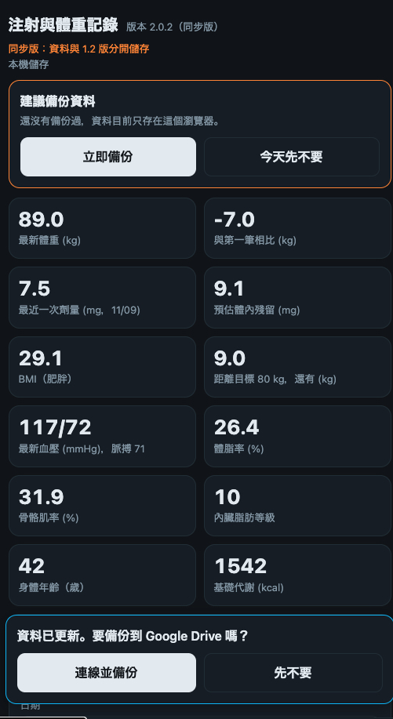
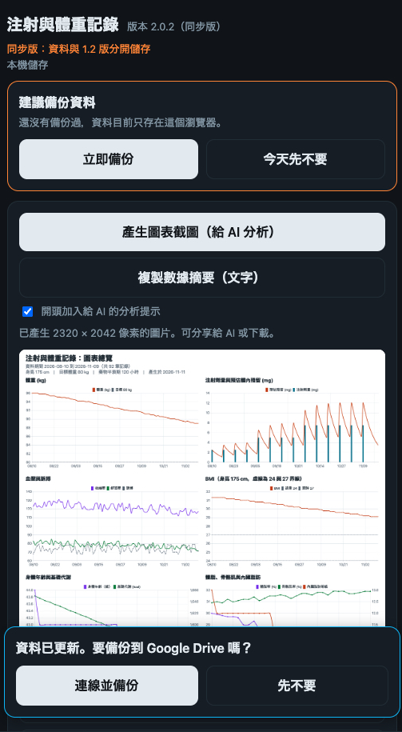
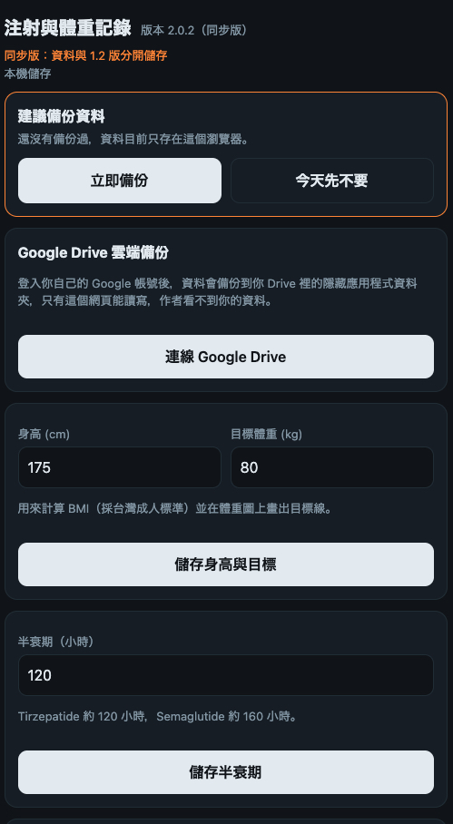

# Dose Tracker Sync (注射與體重記錄 同步版)

[繁體中文](README.md) ｜ **English** ｜ [日本語](README.ja.md)

[](https://ko-fi.com/killnopig)

A single-page web app for your phone that records weekly injection doses, injection sites, weight and related health measurements, and draws charts. Everything lives in one `index.html` file. No server is needed.

**Use it online:** https://killnopig.github.io/dose-tracker-sync/

> This is the "Sync Edition", an independent project that grew out of [dose-tracker](https://github.com/killnopig/dose-tracker) (the stable 1.2 release). It adds blood pressure and body composition, Omron CSV and Health Connect import, chart screenshots and a text summary, and chart tooltips. Data and cloud backups of the two projects are completely separate.

> This app is a personal logging and trend-viewing tool. It is not a medical device and gives no diagnosis, treatment or dosing advice. Please read the Disclaimer below first.

**Language:** this app is available in Traditional Chinese only. There is no English interface. The project is MIT licensed, so you are free to fork it, translate the interface and build your own version (see the build and deploy notes in the [Chinese README](README.md)).

This page is a translation of the main README. The full changelog and a few advanced sections are only in the Chinese README.

## Screenshots

The screenshots use made-up sample data.

| Records | Charts | Settings |
|---|---|---|
|  |  |  |

## Features

- **Records:** date, dose (mg), weight (kg), blood pressure and pulse, body fat, skeletal muscle, visceral fat level, body age, basal metabolic rate, injection site and notes. Past entries can be edited or deleted. Dose and weight can be entered separately.
- **Charts:** weight line chart (with a dashed goal line), dose bars with an estimated body-residual curve, blood pressure, BMI and body composition. Tap or hover to see exact values. Range can be 30 days, 90 days or all.
- **BMI:** calculated from your height, using Taiwan adult categories (under 18.5 underweight, 18.5 to under 24 normal, 24 to under 27 overweight, 27 and above obese).
- **Goal weight:** shows the distance to your goal and draws a goal line.
- **Injection reminder:** the next date is the last injection plus 7 days, and sites rotate in a fixed order: left abdomen, middle abdomen, right abdomen, left thigh, right thigh, left upper arm, right upper arm.
- **Backup and restore:** generate backup text and paste it back to restore, or use Google Drive backup.

## Install to your home screen (Android)

1. Open the URL above in Chrome.
2. Tap the "⋮" menu and choose "Add to Home screen" or "Install app".
3. Open it from the icon from now on.

Always open it the same way, because data is stored per browser (see below).

## Android APK (optional)

You can also install the Android APK. Download the latest `dose-tracker-sync-v2.0.0.apk` from [Releases](https://github.com/killnopig/dose-tracker-sync/releases).

- The APK is only a shell (Capacitor) that loads `https://killnopig.github.io/dose-tracker-sync/`. The content updates automatically when the website updates, so you do not need to reinstall. The real version is the one shown next to the title at the top of the app.
- An internet connection is required to open it.
- Data is stored in the APK's built-in browser, separate from the Chrome web version. Uninstalling the app or clearing its data erases your records, so back up regularly.
- Google Drive backup has been tested on the author's phone only.
- To move from the Chrome version to the APK, connect both to the same Google account and let Drive load the data, or use backup text.
- This build is signed with a debug key and is for personal sideloading only. You need to allow "Install unknown apps". Future APK updates must use the same signing key, otherwise you must uninstall first and your records will be lost.

## Health Connect sync (Android APK)

Only available inside the APK. Health Connect is open only to native Android apps, so the web version cannot use it.

- In Settings, the Omron import card gets a "Sync from Health Connect" button (last 30 days, 90 days or 1 year).
- By default only data whose source name contains Omron is read. Tick "include all sources" to read data written by other apps.
- Readable: blood pressure, pulse, weight, body fat, basal metabolic rate. **Not readable: skeletal muscle, visceral fat, body age.** Keep importing those through the Omron CSV. Entries with the same weight are filled in automatically.
- Nothing is written until you press "Confirm import", and you can undo the last import. Data already imported from CSV is not duplicated.
- Data older than 30 days needs Health Connect's history permission, which some older versions do not support.

## Where your data lives

- By default it is stored in your phone browser's local storage (localStorage). **It is never uploaded to this project or to any server of the author.**
- If you connect Google Drive in Settings, a backup is also kept in the hidden app-data folder of your own Drive (`drive.appdata`). Only this app can read or write it. The author cannot see it.
- Without Google Drive, clearing browser data, uninstalling the browser, or switching phones or browsers can erase your data.
- **Back up regularly:** in Settings press "Generate backup text", copy it, and save it in a notes app or send it to yourself.
- **Restore:** in Settings paste the backup text into the box and press "Restore from text". Restoring replaces current data.

## Google Drive backup

1. In Settings press "Connect Google Drive" and sign in with your own Google account.
2. After that every add, edit or delete is backed up to your Drive automatically.
3. On a new phone, open the page and connect the same account to load the cloud data.
4. If local and cloud data differ, the one modified last wins. They are not merged.
5. To stop, press "Disconnect". This only stops syncing. Existing backup files on Drive are not deleted.
6. On first connect, if the Sync Edition's own backup is empty and the device has no data, the app loads the older cloud backup (the old beta or 1.2, whichever is newer) automatically. This is a copy and does not change the original backups.

## Chart screenshot (for AI analysis)

On the Charts tab press "Generate chart image". The app combines all charts that have data into one image:

- Two columns on a light background, unaffected by dark mode, with the data period, height and goal weight at the top.
- "Share or save image" sends it to a supported AI app. You can also download the PNG or copy the image and paste it into an AI chat.
- The image contains your health data. Think about privacy before sending it to any AI service.
- "Copy data summary" produces a plain-text summary (injection history and intervals, weight change and averages, blood pressure by time of day, body composition, weekly and last-14-day values). AI usually reads numbers in text more accurately than in an image.

## Omron CSV import

1. Export CSV from OMRON connect (blood pressure, weight and body composition can be exported separately).
2. In Settings open the Omron import card and choose one or more files.
3. Check the preview (how many are new, how many duplicates are skipped) and press "Confirm import".
4. If something went wrong, press "Undo last import".

- Blood pressure files: date and time, systolic, diastolic, pulse, and the irregular-pulse and body-movement flags (written to the note).
- Weight and body composition files: weight, body fat, skeletal muscle, visceral fat, body age, basal metabolic rate. BMI is not imported; the app calculates it from your height.
- If the weight equals an entry on the same day, only the missing body composition values are added.
- Columns are detected from header text. If Omron renames a column and import fails, the preview lists the header row so it can be reported.

## How the estimated body residual is calculated

A simplified first-order exponential decay model:

```
residual = Σ dose × 2^(−days elapsed ÷ (half-life hours ÷ 24))
```

- The default half-life is 120 hours (tirzepatide). You can change it in Settings, for example to 160 hours (semaglutide).
- Absorption is assumed to be immediate, so values on the injection day are overestimated.
- The result is only for seeing long-term build-up and decline. **It is not your actual blood concentration and must not be used to decide doses.**

## Known limitations

- No push notifications. Reminders show only when the app is open. Use your phone's clock or calendar for alarms.
- The web version cannot connect to Health Connect; only the Android APK can.
- No offline mode: the chart library needs a network connection on first load.
- The Google Drive access token expires after about one hour. The app keeps recording, but you need to tap the status line at the top or the button in Settings to reconnect and resume syncing.
- The injection site rotation order is fixed.

## Privacy and the public repository

- This repository is public. **Never upload personal records, backup text or CSV files here.**
- Git keeps full history. If personal data was ever uploaded, deleting the file is not enough; clear the history or delete and recreate the repository.
- The app contains no trackers and collects no user data.

## Disclaimer

- This app is a personal logging and trend-viewing tool. It is not a medical device and gives no diagnosis, treatment or dosing advice.
- "Estimated residual" is a simplified estimate and differs from real blood concentration. BMI categories, suggested site and next injection date are only aids. Follow your doctor's or pharmacist's instructions and the product label.
- For medication, dose changes, missed doses or any symptoms, consult your doctor or pharmacist. In an emergency seek medical care immediately.
- Data is entered by you and stored on your own device. Back it up regularly; the author does not guarantee that data will not be lost.
- The app is provided as is, without warranty, and the author is not liable for any consequence of using or being unable to use it.
- This app is not affiliated with any pharmaceutical company or drug brand.

## Version and auto-update

- The current version is shown next to the title at the top of the app and is defined as `APP_VERSION` in `index.html`.
- On opening or returning to the app, it compares its version with the online `index.html`. If they differ, a "New version, tap to update" bar appears.

## Relation to the stable 1.2 release

- The stable 1.2 release stays at [dose-tracker](https://github.com/killnopig/dose-tracker) (`https://killnopig.github.io/dose-tracker/`) and receives no new features.
- The Sync Edition is a separate project (`https://killnopig.github.io/dose-tracker-sync/`), with versions starting at 2.0.0.
- Both live under the same domain, so the Sync Edition always uses its own local storage key (`dosetrack-v1-sync`) and its own Drive backup file (`dose-tracker-sync.json`) and never reads or writes 1.2 data.
- The privacy policy shown on the Google sign-in and Health Connect permission screens is the one in the 1.2 project (`privacy.html`).

## License

MIT License. See the LICENSE file.
