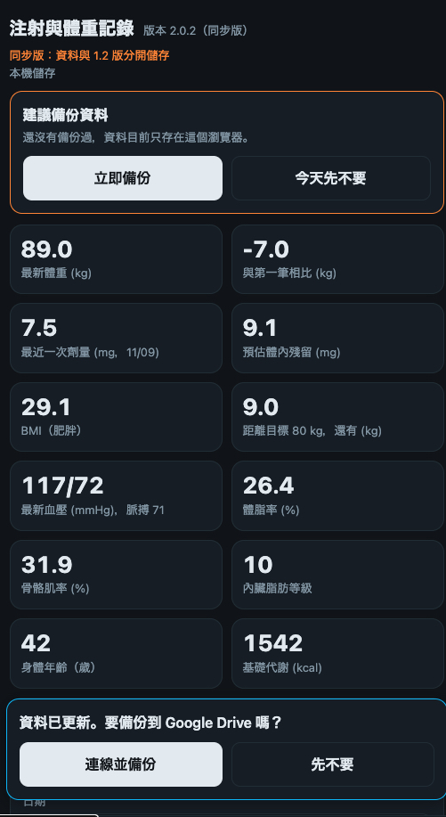
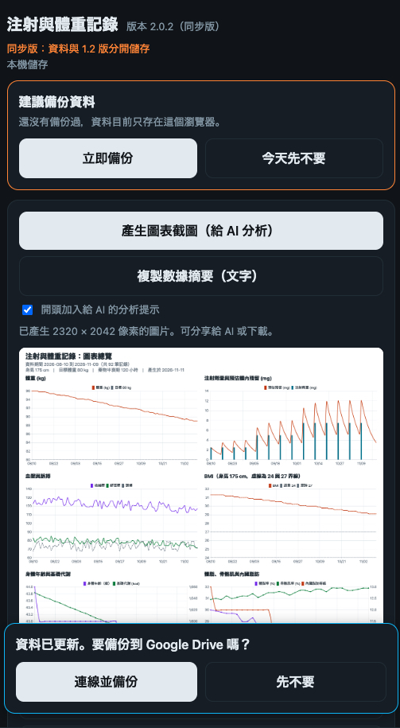
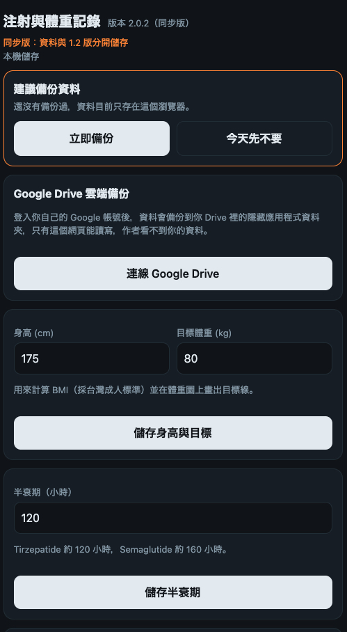

# 注射と体重の記録 同期版 Dose Tracker Sync

[繁體中文](README.md) ｜ [English](README.en.md) ｜ **日本語**

毎週の注射量、注射部位、体重などの健康データを記録し、グラフにするスマートフォン向けのシングルページ Web アプリです。すべての機能が `index.html` 1 ファイルに入っており、サーバーは不要です。

**オンラインで使う:** https://killnopig.github.io/dose-tracker-sync/

> これは「同期版」で、[dose-tracker](https://github.com/killnopig/dose-tracker)（安定版 1.2）から独立したプロジェクトです。血圧と体組成、Omron CSV と Health Connect の取り込み、グラフ画像とテキスト要約、グラフのツールチップなどを追加しています。2 つのプロジェクトのデータとクラウドバックアップは完全に分かれています。

> 本アプリは個人の記録と傾向確認のためのツールです。医療機器ではなく、診断・治療・用量の助言は行いません。下の「免責事項」を先にお読みください。

**言語:** 本アプリは繁体字中国語版のみで、日本語の画面はありません。MIT ライセンスなので、フォークして画面を翻訳し、ご自身でビルドして使うことができます（ビルドと公開の手順は[中国語版 README](README.md) を参照）。

このページはメインの README の翻訳です。変更履歴と一部の詳細な説明は中国語版 README にのみあります。

## 画面イメージ

スクリーンショットは架空のサンプルデータです。

| 記録 | グラフ | 設定 |
|---|---|---|
|  |  |  |

## 機能

- **記録:** 日付、注射量（mg）、体重（kg）、血圧と脈拍、体脂肪率、骨格筋率、内臓脂肪レベル、体内年齢、基礎代謝、注射部位、メモ。過去の記録は編集・削除できます。注射量と体重はどちらか一方だけでも入力できます。
- **グラフ:** 体重の折れ線（目標体重の点線つき）、注射量の棒と推定体内残量の曲線、血圧、BMI、体組成。タップまたはホバーで数値を表示。期間は 30 日、90 日、全期間から選べます。
- **BMI:** 身長から自動計算し、台湾の成人基準で分類します（18.5 未満は低体重、18.5 以上 24 未満は標準、24 以上 27 未満は過体重、27 以上は肥満）。
- **目標体重:** 目標との差を表示し、グラフに目標線を描きます。
- **注射リマインダー:** 最後の注射日に 7 日を足して次回日を計算し、部位は左腹、腹中央、右腹、左太もも、右太もも、左上腕、右上腕の順に回ります。
- **バックアップと復元:** バックアップ用テキストを作成して貼り付けると復元できます。Google Drive バックアップも使えます。

## ホーム画面に追加する（Android）

1. Chrome で上の URL を開きます。
2. 右上の「⋮」から「ホーム画面に追加」または「アプリをインストール」を選びます。
3. 以後はアイコンから開きます。

データはブラウザごとに保存されるため、いつも同じ方法で開いてください（下記参照）。

## Android APK（任意）

Android APK もインストールできます。[Releases](https://github.com/killnopig/dose-tracker-sync/releases) から最新の `dose-tracker-sync-v2.0.0.apk` をダウンロードしてください。

- APK は `https://killnopig.github.io/dose-tracker-sync/` を読み込むだけの殻（Capacitor）です。サイトが更新されるとアプリの内容も自動で更新されるため、再インストールは不要です。実際のバージョンはアプリ上部のタイトル横に表示されます。
- 開くにはネットワーク接続が必要です。
- データは APK 内蔵のブラウザに保存され、Chrome の Web 版とは別です。アプリを削除するかデータを消去すると記録も消えるため、定期的にバックアップしてください。
- Google Drive バックアップは作者のスマートフォンでのみ動作確認しています。
- Chrome 版から APK に移すには、両方を同じ Google アカウントに接続して Drive から読み込むか、バックアップテキストを使います。
- このビルドは debug 署名で、個人用のサイドロード専用です。「提供元不明のアプリ」を許可する必要があります。今後の APK 更新は同じ署名鍵が必要で、違う場合は先にアンインストールするため記録が消えます。

## Health Connect 同期（Android APK）

APK 内でのみ表示されます。Health Connect は Android のネイティブアプリ専用のため、Web 版では使えません。

- 「設定」の Omron 取り込みカードに「Health Connect から同期」が追加されます（直近 30 日、90 日、1 年）。
- 既定ではソース名に Omron を含むデータだけを読み取ります。「すべてのソースを含める」にチェックすると他のアプリが書き込んだデータも読みます。
- 読み取れるもの: 血圧、脈拍、体重、体脂肪率、基礎代謝。**読み取れないもの: 骨格筋率、内臓脂肪、体内年齢。** これらは引き続き Omron CSV で取り込んでください。体重が同じ記録には自動で補われます。
- 「取り込みを確定」を押すまで書き込まれず、直前の取り込みは取り消せます。CSV で取り込み済みのデータは重複しません。
- 30 日より前のデータには Health Connect の履歴読み取り権限が必要で、古いバージョンでは使えない場合があります。

## データの保存場所

- 既定では、お使いのスマートフォンのブラウザのローカルストレージ（localStorage）に保存されます。**本プロジェクトや作者のサーバーには一切アップロードされません。**
- 「設定」で Google Drive に接続すると、ご自身の Drive の非表示アプリデータフォルダ（`drive.appdata`）にもバックアップされます。読み書きできるのは本アプリだけで、作者には見えません。
- Google Drive に接続していない場合、ブラウザデータの消去、ブラウザの削除、機種変更やブラウザの変更でデータが消えることがあります。
- **定期的にバックアップしてください:** 「設定」で「バックアップテキストを作成」を押し、コピーしてメモアプリなどに保存するか、自分に送ってください。
- **復元:** 「設定」でバックアップテキストをテキスト欄に貼り付け、「テキストから復元」を押します。復元は現在のデータを置き換えます。

## Google Drive バックアップ

1. 「設定」で「Google Drive に接続」を押し、ご自身の Google アカウントでログインして許可します。
2. 以後、記録の追加・編集・削除のたびに Drive へ自動でバックアップされます。
3. 機種変更時は、ページを開いて同じアカウントに接続すると、クラウドのデータが自動で読み込まれます。
4. ローカルとクラウドで内容が違う場合は、最後に更新された方が優先され、マージはされません。
5. 停止するには「接続を解除」を押します。同期が止まるだけで、Drive 上のバックアップファイルは削除されません。
6. 初回接続時、同期版自身のバックアップが空で端末にもデータがない場合は、古いクラウドバックアップ（旧テストバージョンまたは 1.2、新しい方）を自動で読み込みます。これはコピーで、元のバックアップは変わりません。

## グラフ画像（AI 分析用）

「グラフ」タブで「グラフ画像を作成」を押すと、データのあるグラフをすべて 1 枚の画像にまとめます。

- 2 列、明るい背景で、ダークモードの影響を受けません。上部にデータ期間、身長、目標体重を表示します。
- 「画像を共有または保存」で対応する AI アプリに直接送れます。PNG のダウンロードや画像のコピーをして AI のチャットに貼ることもできます。
- 画像にはあなたの健康データが含まれます。AI サービスに送る前にプライバシーを確認してください。
- 「データ要約をコピー」はテキストの要約（注射の履歴と間隔、体重の変化と平均、時間帯別の血圧、体組成、週ごとと直近 14 日の日別）を作ります。AI は画像より文字の数値の方が正確に読み取れることが多いです。

## Omron CSV の取り込み

1. OMRON connect から CSV を書き出します（血圧、体重、体組成は別々でも構いません）。
2. 「設定」の Omron 取り込みカードで 1 つ以上のファイルを選びます。
3. プレビュー（新規何件、重複で除外何件）を確認し、「取り込みを確定」を押します。
4. 間違えたときは「直前の取り込みを取り消す」を押します。

- 血圧ファイル: 測定日時、収縮期血圧、拡張期血圧、脈拍、不規則脈波と体動の検出結果（メモに記録）。
- 体重・体組成ファイル: 体重、体脂肪、骨格筋、内臓脂肪、体内年齢、基礎代謝。BMI は取り込まず、身長からアプリが計算します。
- 同じ日の記録と体重が同じ場合は、不足している体組成の値だけを追加します。
- 列は見出しの文字から自動判別します。Omron が列名を変えて読み取れない場合、プレビューに見出し行が表示されるので、報告に使えます。

## 推定体内残量の計算方法

簡略化した 1 次の指数減衰モデルです。

```
残量 = Σ 注射量 × 2^(−経過日数 ÷ (半減期の時間 ÷ 24))
```

- 既定の半減期は 120 時間（チルゼパチド）です。「設定」で 160 時間（セマグルチド）などに変更できます。
- 注射後すぐに完全に吸収されると仮定しているため、注射当日の値は高めに出ます。
- 結果は長期的な蓄積と減衰の傾向を見るためだけのものです。**実際の血中濃度ではなく、用量の判断に使ってはいけません。**

## 既知の制限

- プッシュ通知はありません。リマインダーはアプリを開いたときだけ表示されます。アラームが必要な場合は、スマートフォンの時計やカレンダーを使ってください。
- Web 版は Health Connect に接続できません。Android APK のみ対応です。
- オフラインモードはありません。初回はグラフライブラリの読み込みにネットワークが必要です。
- Google Drive のアクセストークンは約 1 時間で期限切れになります。期限後も記録はできますが、同期を再開するには画面上部のステータス行か「設定」のボタンで再接続が必要です。
- 注射部位のローテーション順は固定で、変更できません。

## プライバシーと公開リポジトリについて

- このリポジトリは公開されています。**個人の記録、バックアップテキスト、CSV は絶対にアップロードしないでください。**
- Git は履歴をすべて保持します。誤って個人データをアップロードした場合、ファイルを削除するだけでは足りません。履歴を消去するか、リポジトリを削除して作り直してください。
- 本アプリにはトラッキングが含まれず、ユーザーデータも収集しません。

## 免責事項

- 本アプリは個人の記録と傾向確認のためのツールです。医療機器ではなく、診断・治療・用量の助言は行いません。
- 「推定体内残量」は簡略化した推定で、実際の血中濃度とは異なります。BMI の分類、推奨部位、次回注射日は補助的な目安にすぎません。医師や薬剤師の指示と製品の添付文書に従ってください。
- 服薬、用量の調整、打ち忘れ、体調の異変については、医師または薬剤師に相談してください。緊急の場合はすぐに受診してください。
- データは利用者が入力し、利用者自身の端末に保存されます。定期的にバックアップしてください。データが失われないことを作者は保証しません。
- 本アプリは現状のまま提供され、いかなる保証もありません。使用または使用できないことによる結果について、作者は責任を負いません。
- 本アプリは、いかなる製薬会社や医薬品ブランドとも関係ありません。

## バージョンと自動更新

- 現在のバージョンはアプリ上部のタイトル横に表示され、`index.html` の `APP_VERSION` で定義されています。
- アプリを開いたとき、またはバックグラウンドから戻ったときに、オンラインの `index.html` とバージョンを比較し、異なる場合は「新しいバージョンがあります。タップして更新」が表示されます。

## 安定版 1.2 との関係

- 安定版 1.2 は [dose-tracker](https://github.com/killnopig/dose-tracker)（`https://killnopig.github.io/dose-tracker/`）に残り、新機能は追加されません。
- 同期版は独立したプロジェクト（`https://killnopig.github.io/dose-tracker-sync/`）で、バージョンは 2.0.0 から始まります。
- 両者は同じドメイン上にあるため、同期版は専用のローカルストレージキー（`dosetrack-v1-sync`）と専用の Drive バックアップファイル（`dose-tracker-sync.json`）を使い、1.2 のデータは読み書きしません。
- Google ログイン画面と Health Connect の権限画面に表示されるプライバシーポリシーは、1.2 プロジェクトの `privacy.html` です。

## ライセンス

MIT License。詳細は LICENSE ファイルを参照してください。
