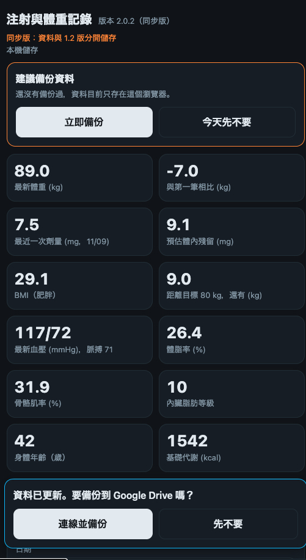
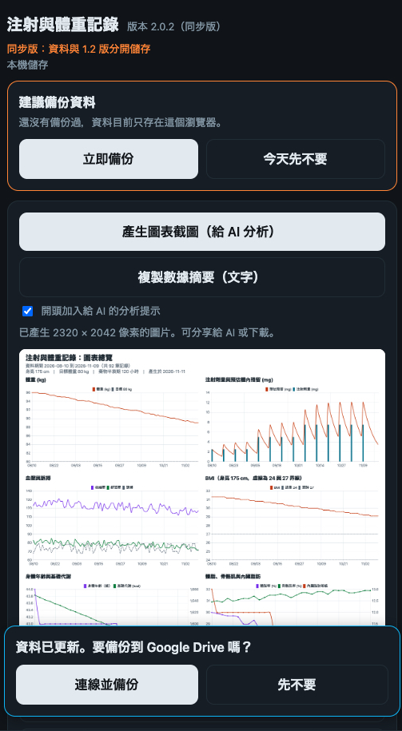
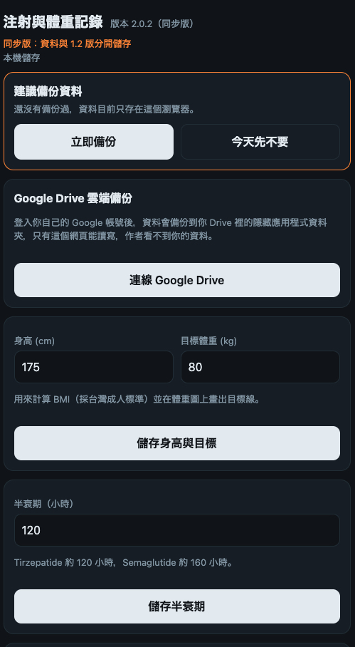

# 注射與體重記錄 同步版 Dose Tracker Sync

**繁體中文** ｜ [English](README.en.md) ｜ [日本語](README.ja.md)

一個在手機上使用的單頁網頁 app，用來記錄每週注射劑量、注射部位與體重，並畫出圖表。所有功能都在一個 `index.html` 檔案裡，不需要安裝、不需要伺服器。

**線上使用：** https://killnopig.github.io/dose-tracker-sync/

> 這是「同步版」，由 [dose-tracker](https://github.com/killnopig/dose-tracker)（1.2 穩定版）延伸出來的獨立專案，新增血壓與體組成、Omron CSV 與 Health Connect 匯入、圖表截圖與數據摘要、圖表互動提示等功能。兩個專案的資料與雲端備份檔完全分開，互不影響。

> 本 app 是個人記錄與趨勢檢視工具，不是醫療器材，不提供診斷、治療或用藥建議。請先閱讀下方〈免責聲明〉。

## 畫面預覽

以下截圖使用的是示範用的假資料。

| 記錄 | 圖表 | 設定 |
|---|---|---|
|  |  |  |

## 功能

- **記錄：** 日期、注射劑量（mg）、體重（kg）、血壓與脈搏、體脂率、骨骼肌率、內臟脂肪等級、身體年齡、基礎代謝、注射部位、備註，歷史記錄可編輯或刪除。劑量與體重可只填其中一項。
- **圖表：** 體重折線圖（可顯示目標體重虛線）、劑量長條圖搭配預估體內殘留曲線。
- **BMI：** 輸入身高後自動計算，分類採台灣成人標準（低於 18.5 過輕、18.5 到未滿 24 正常、24 到未滿 27 過重、27 以上肥胖）。
- **目標體重：** 顯示與目標的差距，並在圖上畫出目標線。
- **注射提醒：** 依最近一次注射推算下次日期（加 7 天），並依序輪替部位：左腹、腹中、右腹、左大腿、右大腿、左上臂、右上臂。
- **備份與還原：** 一鍵產生備份文字，貼回即可還原。

## 安裝到手機主畫面（Android）

1. 用 Chrome 開啟上面的網址。
2. 點右上角「⋮」，選「加到主畫面」或「安裝應用程式」。
3. 之後從桌面圖示開啟。

請固定使用同一種方式開啟，因為資料是依瀏覽器各自儲存的（見下節）。

## Android APK（選用）

除了「加到主畫面」，也可以安裝 Android APK：到 [Releases](https://github.com/killnopig/dose-tracker-sync/releases) 下載最新的 `dose-tracker-sync-v2.0.0.apk`。

- APK 只是載入 `https://killnopig.github.io/dose-tracker-sync/` 的外殼（Capacitor）。網站更新時 app 內容會自動跟著更新，不需要重新安裝；實際版本以 app 最上方標題旁顯示的版本號為準。
- 需要網路才能開啟，沒有網路時無法載入。
- 資料存在 APK 內嵌的瀏覽器，與 Chrome 網頁版分開。解除安裝或清除 app 資料會遺失記錄，請定期在「設定」按「產生備份文字」另存。
- Google Drive 備份在作者的手機上測試可正常使用，其他機型未測。
- 從 Chrome 網頁版換到 APK：在網頁版「產生備份文字」，到 APK「從文字還原」；或兩邊連線同一個 Google 帳號，由 Drive 載入。
- 此版本使用 debug 簽章，僅供個人側載。安裝時需允許「安裝未知應用程式」。之後更新 APK 必須使用同一把簽章金鑰，否則要先解除安裝，記錄會一併消失。

## Health Connect 同步（Android APK）

只有在 APK 內才會出現。網頁版沒有這個功能，因為 Health Connect 只開放給 Android 原生 app。

- 「設定」→「匯入 Omron CSV」卡片中會多一個「從 Health Connect 同步」，可選最近 30 天、90 天或 1 年。
- 預設只取來源名稱含 Omron 的資料；勾選「包含所有來源」才會取其他 app 寫入的資料。
- 能讀到：血壓、脈搏、體重、體脂率、基礎代謝。**讀不到：骨骼肌率、內臟脂肪、身體年齡**，請繼續用 Omron CSV 匯入；體重相同的記錄會自動補上這些欄位。
- 預覽後按「確認匯入」才會寫入，可按「復原上次匯入」。與 CSV 已匯入的資料不會重複。
- 超過 30 天前的資料需要 Health Connect 的歷史讀取權限，部分舊版 Health Connect 不支援。

### 重新建置 APK（在 Mac 上）

專案資料夾以 `~/Desktop/dose-tracker-app` 為例。

1. 安裝外掛。外掛的主版本要和 Capacitor 相同，先用 `npx cap --version` 查看：
   ```bash
   cd ~/Desktop/dose-tracker-app
   npm install @capgo/capacitor-health @capacitor/share @capacitor/filesystem
   npx cap sync android
   ```
2. 編輯 `android/app/src/main/AndroidManifest.xml`，在 `<manifest>` 裡、`<application>` 之外加入：
   ```xml
   <uses-permission android:name="android.permission.health.READ_BLOOD_PRESSURE" />
   <uses-permission android:name="android.permission.health.READ_BODY_FAT" />
   <uses-permission android:name="android.permission.health.READ_BASAL_METABOLIC_RATE" />
   <uses-permission android:name="android.permission.health.READ_HEALTH_DATA_HISTORY" />
   ```
   外掛本身只預先宣告體重、心率等基本項目，血壓、體脂、基礎代謝要自己加。
3. 編輯 `android/app/src/main/res/values/strings.xml`，在 `<resources>` 裡加入隱私權政策連結（Health Connect 授權畫面會用到）：
   ```xml
   <string name="health_connect_privacy_policy_url">https://killnopig.github.io/dose-tracker/privacy.html</string>
   ```
4. 如果編譯時出現 minSdk 相關錯誤，把 `android/variables.gradle` 的 `minSdkVersion` 改成 26 以上。
5. 把 `android/app/build.gradle` 的 `versionCode` 加 1、`versionName` 改成新版本，才能覆蓋安裝舊版。
6. 用 Android Studio 開啟（`npx cap open android`），Build → Build APK(s)。使用同一台 Mac 的預設 debug 金鑰，簽章不變，可直接覆蓋安裝，記錄不會消失。
7. 安裝後第一次按「授權並讀取 Health Connect」，在系統畫面勾選全部項目。

## 資料存在哪裡

- 預設存在你自己手機瀏覽器的本機儲存空間（localStorage），**不會上傳到本專案或作者的任何伺服器**。
- 若你在「設定」連線 Google Drive，資料也會備份到你自己 Drive 的隱藏應用程式資料夾（`drive.appdata`），只有本 app 能讀寫，作者看不到。
- 沒有連線 Google Drive 時，清除瀏覽資料、解除安裝瀏覽器、換手機或換瀏覽器，資料都可能消失。
- **請定期備份：** 到「設定」按「產生備份文字」，複製後貼到備忘錄或傳給自己保存。
- **還原：** 到「設定」，把備份文字貼進文字框，按「從文字還原」。還原會取代目前資料。

## Google Drive 雲端備份

1. 到「設定」按「連線 Google Drive」，用你自己的 Google 帳號登入並同意授權。
2. 之後每次新增、修改或刪除記錄，都會自動備份到你的 Drive。
3. 換手機時，開啟網頁、連線同一個 Google 帳號，就會自動載入雲端資料。
4. 本機與雲端衝突時，以最後修改時間較新的為準，不會合併。
5. 想停用請按「中斷連線」。這只會停止同步，Drive 上已有的備份檔不會被刪除。

### 自己架一份時的設定（Google Client ID）

1. 到 [Google Cloud Console](https://console.cloud.google.com/) 建立專案。
2. 啟用 **Google Drive API**。
3. 設定 OAuth 同意畫面：類型選「外部」，加入範圍 `https://www.googleapis.com/auth/drive.appdata`。
4. 在「憑證」建立 **OAuth 用戶端 ID**，類型選「網頁應用程式」，已授權的 JavaScript 來源填你的網站來源，例如 `https://killnopig.github.io`（不含路徑）。
5. 把產生的用戶端 ID 貼到 `index.html` 裡的 `GOOGLE_CLIENT_ID`。
6. 應用程式若停在「測試」狀態，只有你加入的測試使用者能登入；要開放給所有人，需發布為「正式版」。用戶端 ID 本身是公開資訊，可以放在公開 repository。

## 圖表截圖（給 AI 分析）

在「圖表」頁按「產生圖表截圖」，app 會把目前有資料的所有圖表合成一張圖片：

- 兩欄排列、淺色背景，不受深色模式影響，圖片上方有資料期間、身高、目標體重等說明。
- 按「分享或儲存圖片」可直接送到支援的 AI app；也可以「下載 PNG」或「複製圖片」後貼到 AI 對話。
- 多數 AI 服務會把過大的圖片縮小，所以採兩欄排列，避免圖片過長而字太小。
- 圖片包含你的健康數據，傳給 AI 服務前請自行評估隱私。
- 「複製數據摘要」會產生純文字摘要（注射歷程與間隔、體重變化與平均、血壓分時段統計、體組成、每週與近 14 天逐日），可與圖片一起貼給 AI；AI 讀文字數字通常比讀圖更準確。

## 匯入 Omron CSV

1. 在 OMRON connect 匯出 CSV（血壓、體重、體組成可以分開匯出）。
2. 到「設定」→「匯入 Omron CSV」，選擇一個或多個檔案。
3. 檢視預覽（新增幾筆、重複略過幾筆），按「確認匯入」。
4. 匯入有誤，可以按「復原上次匯入」。

- 血壓檔：讀取測量日期與時間、收縮壓、舒張壓、脈搏，以及不規則脈波與身體晃動的偵測結果（寫入備註）。
- 體重與體組成檔：讀取體重、體脂、骨骼肌、內臟脂肪、身體年齡、基礎代謝；BMI 欄位不匯入，由 app 依身高計算。
- 體重若與同一天已有的記錄相同，只會補上缺少的體組成數值，不會新增重複的體重。
- 欄位是依標題列的文字自動辨識，若 Omron 改了欄位名稱而讀不出來，預覽會列出標題列，方便回報修正。

## 從其他 App 或 Excel 匯入

不同 App 的匯出格式差異很大，建議請 AI 幫你轉成本 app 能讀的格式：

1. 複製下面的提示詞（app 的「設定」→「從其他 App 或 Excel 匯入」也有一鍵複製按鈕）。
2. 貼到你慣用的 AI 對話，並把你的記錄貼在最後面。
3. 把 AI 回覆的 JSON 貼進「設定」的備份文字框，按「從文字還原」。

還原會取代目前所有資料，請先「產生備份文字」另存。你的記錄會傳給你使用的 AI 服務，請自行評估隱私。

```
請把我貼上的施打與體重記錄，轉換成下面格式的 JSON。只輸出 JSON，不要加任何說明文字。

格式：
{"entries":[{"date":"YYYY-MM-DD","dose":劑量數字,"wt":體重數字,"sys":收縮壓,"dia":舒張壓,"pul":脈搏,"fat":體脂率,"mus":骨骼肌率,"vis":內臟脂肪等級,"bage":身體年齡,"bmr":基礎代謝,"site":"部位","note":"備註"}],"hl":120,"h":0,"tw":0}

規則：
1. date 必須是 YYYY-MM-DD。如果我的資料沒有年份，或日期有歧義（例如 03/04 可能是 3 月 4 日或 4 月 3 日），請先問我，不要自己猜。
2. dose 是注射劑量（mg），wt 是體重（kg），sys／dia／pul 是收縮壓／舒張壓（mmHg）／脈搏（次/分），fat／mus 是體脂率／骨骼肌率（%），vis 是內臟脂肪等級，bage 是身體年齡（歲），bmr 是基礎代謝（kcal）。同一次量測的數值放同一筆；沒有的項目一律填 0。
3. 如果體重單位是磅（lb），請換算成公斤，四捨五入到小數 1 位。
4. site 只能是這七個之一：左腹、腹中、右腹、左大腿、右大腿、左上臂、右上臂。沒有部位或對不上就填空字串 ""，並把原本的部位文字寫進 note。
5. 依日期由舊到新排序。
6. 資料裡沒有的內容不要編造。
7. hl 是藥物半衰期（小時），不知道就填 120；h 是身高（cm）、tw 是目標體重（kg），不知道就填 0。

以下是我的資料：
（把你的記錄貼在這裡）
```

## 預估體內殘留量怎麼算

採簡化的一階指數衰減模型：

```
殘留量 = Σ 劑量 × 2^(−經過天數 ÷ (半衰期小時 ÷ 24))
```

- 預設半衰期 120 小時（Tirzepatide），可在「設定」改成 160 小時（Semaglutide）或其他數值。
- 假設注射後立即完全吸收，實際上藥物吸收需要時間，所以注射當天的數值會偏高。
- 結果只適合看長期累積與衰退的趨勢，**不等於實際血中濃度，不可用來決定劑量**。

## 部署（給想自己架一份的人）

1. 建立 GitHub repository，上傳 `index.html`（檔名必須是 `index.html`）。
2. 到 Settings → Pages，Source 選「Deploy from a branch」，Branch 選 `main`、資料夾選 `/ (root)`。
3. 等 1 到 2 分鐘，網址為 `https://<帳號>.github.io/<repo 名稱>/`。

圖表使用 Chart.js 4.4.1，由 cdnjs 載入，所以第一次開啟需要網路。

## 已知限制

- 沒有推播通知，提醒只有在打開 app 時才看得到。想要鬧鐘式提醒，請另外在手機時鐘或行事曆設定。
- 網頁版無法串接 Google Health Connect，只有 Android APK 可以（見上方〈Health Connect 同步〉）。
- 沒有離線模式：首次載入圖表函式庫需要網路。
- Google Drive 備份使用的存取權杖約 1 小時後過期。過期後 app 仍可正常記錄，但要點頁面上方的狀態行或「設定」裡的按鈕重新連線，才會繼續同步。
- 注射部位的輪替順序固定，無法自訂。

## 隱私與公開倉庫注意事項

- 這個 repository 是公開的，**請不要把任何個人記錄、備份文字或 CSV 上傳進來**。
- Git 會保留完整歷史。如果不小心上傳過個人資料，只刪除檔案並不夠，歷史紀錄仍然看得到，需要清除歷史或直接刪掉整個 repository 重建。
- 本 app 不含追蹤程式，也不收集任何使用者資料。

## 免責聲明

- 本 app 是個人記錄與趨勢檢視工具，不是醫療器材，不提供診斷、治療或用藥建議。
- 「預估體內殘留」是簡化估算，與實際血中濃度不同；BMI 分類與「建議部位、下次注射日」只是輔助提醒。請以醫師或藥師的指示和藥品仿單為準。
- 用藥、調整劑量、漏打或出現不適症狀時，請諮詢你的醫師或藥師；緊急狀況請立即就醫。
- 資料由使用者自行輸入並儲存在自己的裝置上，請自行定期備份，作者不保證資料不會遺失。
- 本 app 按現狀提供，不附任何保證，作者不對因使用或無法使用本 app 造成的任何後果負責。
- 本 app 與任何藥廠或藥品品牌無關。

## 版本與自動更新

- 目前版本顯示在 app 最上方標題旁，版本號定義在 `index.html` 裡的 `APP_VERSION`。
- 版本號遵循 `主版本.次版本.修補版本`：修錯字或小問題升修補版本（1.0.1），新增功能升次版本（1.1.0），資料格式有不相容的改動才升主版本（2.0.0）。
- 每次打開 app 或從背景切回來時，app 會比對線上 `index.html` 的版本號。若不同，頁面上方會出現「有新版本，點此更新」，點一下即重新載入。
- 發布新版時，記得先把 `APP_VERSION` 改成新版號，再上傳 `index.html`，否則使用者不會收到更新提示。

## 版本紀錄

### 2.0.2（2026-11-11）
- 移除設定頁的「從其他版本匯入資料」區塊（連線後已會自動載入舊備份）。

### 2.0.1（2026-11-11）
- 連線 Google Drive 後，若同步版自己的備份檔是空的、本機也沒資料，會自動從舊備份（舊測試版、1.2 版，挑較新的那份）載入並顯示提示，不必再手動匯入；之後備份進同步版自己的檔案。

### 2.0.0（2026-11-11）
- 從 dose-tracker 1.9.11 獨立出來，成為「同步版」專案：固定使用自己的儲存鍵與 Drive 備份檔；「匯入其他版本資料」可選 1.2 版或舊測試版。

### 1.9.11（2026-11-11）
- 備份到 Google Drive 成功或失敗時，畫面下方浮出 3 秒的提示（「✓ 已備份到 Google Drive」或「✗ 備份失敗，資料仍在本機」），不必再去看上方的狀態列。

### 1.9.10（2026-11-11）
- 新增、編輯、刪除、還原、復原等任何修改後，若尚未連線 Google Drive 或登入已過期，畫面下方會詢問是否備份；已連線且登入有效時自動備份，不再詢問。可在設定關閉詢問。

### 1.9.9（2026-11-11）
- 從 Health Connect 同步或匯入 Omron CSV 並確認後，會詢問是否備份到 Google Drive；已連線時會自動備份並提示，登入過期時可直接重新連線。

### 1.9.8（2026-11-11）
- 記錄列表可排序（新到舊、舊到新）、依類型篩選（注射、體重、血壓、體組成）、依月份跳轉，並顯示符合筆數；「顯示更多」旁新增「全部顯示」。排序與類型選擇會記住。

### 1.9.7（2026-11-11）
- APK 內的圖表截圖改用 Android 系統分享選單（需要 @capacitor/share 與 @capacitor/filesystem 外掛，見〈重新建置 APK〉）；APK 內不再顯示無效的「下載 PNG」「複製圖片」。網頁版不變。

### 1.9.6（2026-11-11）
- 測試版新增「匯入正式版資料」：從你 Drive 裡正式版的備份檔複製一份到測試版，不會改動正式版備份。

### 1.9.5（2026-11-11）
- 修正 APK 內偵測不到 Health Connect 外掛的問題：優先使用 Capacitor 已註冊的外掛，並在失敗時顯示具體錯誤。

### 1.9.4（2026-11-11）
- Health Connect 偵測改為較寬鬆的判斷，並在 Android 上偵測不到時顯示診斷文字，方便排查。

### 1.9.3（2026-11-11）
- 加入 app 圖示：網頁分頁圖示、iOS／Android 加到主畫面的圖示，APK 另有對應的圖示檔。

### 1.9.2（2026-11-11）
- 「距離目標」卡片文字改為「距離目標 80 kg，還有 (kg)」，意思更清楚。

### 1.9.1（2026-11-11）
- 設定頁最上方改為 Google Drive 雲端備份。

### 1.9.0（2026-11-11）
- 血壓圖可切換「全部量測／每日平均／早晚分開」，資料很多時趨勢更清楚；早上以 12:00 前為準，沒有量測時間的記錄不納入早晚圖。
- 圖表頁新增範圍切換：近 30 天、近 90 天、全部（只影響圖表與截圖，不刪資料）。
- 備份提醒：超過設定天數沒備份、且期間有新記錄時，記錄頁頂端會提醒；可在設定改天數或關閉。
- 外觀：設定中可選跟隨系統、淺色或深色主題。
- 下次注射倒數：到期當天或逾期時以強調色顯示。
- 圖表選項、主題與提醒設定只存在該裝置，不列入備份。

### 1.8.0（2026-11-11）
- 圖表可以用游標或手指查看當天數據：滑到圖上會出現垂直參考線和提示框，顯示完整日期與星期、各項數值，以及當天的注射部位、量測時間、BMI 等補充資訊。
- 手指左右拖曳可在圖上移動，上下拖曳仍可捲動頁面。

### 1.7.0（2026-11-11）
- 新增「從 Health Connect 同步」（僅 Android APK 中顯示）：讀取 Omron 寫入的血壓、脈搏、體重、體脂、基礎代謝，沿用 Omron CSV 的重複判斷與預覽，並可復原。
- 血壓的重複判斷不再比對脈搏，量測時間相差 2 分鐘內視為同一筆，避免 CSV 與 Health Connect 重複匯入。

### 1.6.1（2026-11-10）
- 圖表頁新增「複製數據摘要」：產生純文字摘要（注射歷程、體重、血壓、體組成、每週與近 14 天逐日），可選擇在開頭加入給 AI 的分析提示。

### 1.6.0（2026-11-10）
- 圖表頁新增「產生圖表截圖」：把目前所有圖表合成一張高解析度圖片（淺色底），可分享、下載或複製，方便交給 AI 分析。

### 1.5.0（2026-11-10）
- 新增「匯入 Omron CSV」：可一次選多個檔案，自動辨識血壓、體重與體組成欄位，匯入前預覽，重複資料不重複加入，並可復原上次匯入。
- 歷史記錄預設只顯示最近 30 筆，可按「顯示更多」展開。

### 1.4.3（2026-11-10）
- 修正體重、劑量、血壓圖表無法顯示的問題（網頁元素編號重複）。
- 版本號移到頁面最上方標題旁。

### 1.4.2（2026-11-10）
- 圖表改為各自獨立建立，單一圖表出錯不會影響其他圖表，並在卡片內顯示錯誤原因。
- 圖表函式庫載入失敗時顯示提示。資料點很多時縮小點的大小。

### 1.4.1（2026-11-10）
- 「備份與還原」新增「選擇備份檔」，記錄很多時不必手動貼上整段文字。

### 1.4.0（2026-11-10）
- 新增身體年齡與基礎代謝記錄，圖表頁新增 BMI 圖（含 24、27 界線）與身體年齡／基礎代謝圖。
- 測試版（網址含 `beta`）的資料與雲端備份檔與正式版完全分開，頁面會標示「測試版」。

### 1.3.0（2026-11-10）
- 新增血壓（收縮壓、舒張壓）、脈搏、體脂率、骨骼肌率、內臟脂肪等級的記錄，圖表頁新增對應圖表，並納入備份與還原。
- 沒有輸入過的項目，對應的統計卡片和圖表不會顯示。

### 1.2.0（2026-11-10）
- 設定頁新增「從其他 App 或 Excel 匯入」說明與 AI 轉換提示詞。
- 還原時自動略過日期格式不正確的記錄，並相容 AI 回覆常帶的程式碼區塊符號。

### 1.1.0（2026-11-10）
- 歷史記錄可以直接編輯（日期、劑量、體重、部位、備註）。

### 1.0.0（2026-11-10）
- 記錄注射劑量、部位、體重，並提供圖表。
- BMI、目標體重線、注射部位輪替與下次注射提醒。
- Google Drive 雲端備份（`drive.appdata`）。
- 備份與還原、免責聲明、版本檢查與更新提示。

## 與 1.2 穩定版的關係

- 1.2 穩定版維持在 [dose-tracker](https://github.com/killnopig/dose-tracker)，網址 `https://killnopig.github.io/dose-tracker/`，不再加入新功能。
- 同步版是獨立專案，網址 `https://killnopig.github.io/dose-tracker-sync/`，版本號從 2.0.0 開始。
- 兩者在同一個網域下，所以同步版固定使用自己的本機儲存鍵（`dosetrack-v1-sync`）與 Google Drive 備份檔（`dose-tracker-sync.json`），不會讀寫 1.2 版的資料。
- 從 1.2 版或舊測試版搬資料：到同步版「設定」→ Google Drive，連線 Google Drive 後，若同步版自己的備份是空的、本機也沒有資料，會自動從舊測試版或 1.2 版的雲端備份載入（挑較新的一份）。這是複製，原本版本的備份不受影響。
- Google 登入同意畫面與 Health Connect 授權畫面的隱私權政策，沿用 1.2 專案的 `privacy.html`。

## 授權

本專案以 MIT License 授權，詳見 LICENSE 檔。
